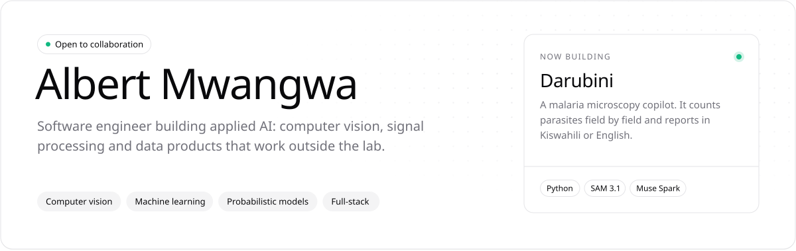
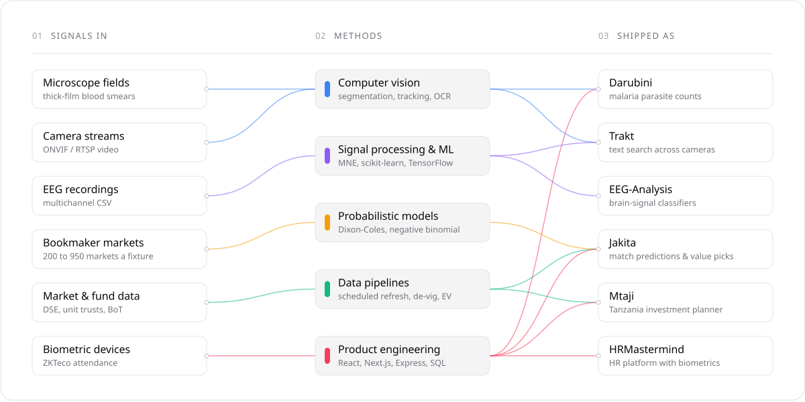
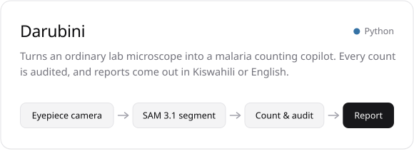
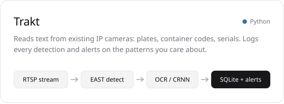
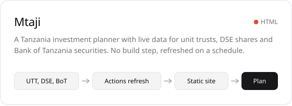
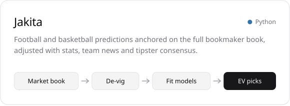
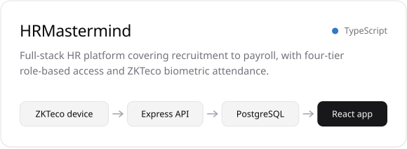
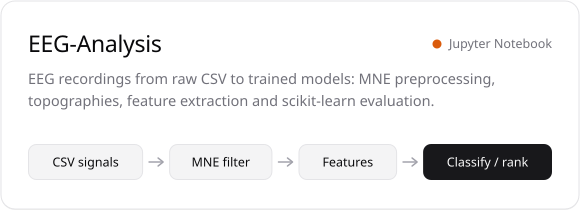

<a href="https://github.com/albertmwangwa">
  <picture>
    <source media="(prefers-color-scheme: dark)" srcset="assets/header-dark.svg">
    
  </picture>
</a>

I build software that turns messy, real-world signals into something people can act on: a parasite count from a microscope, a searchable log from a CCTV feed, a forecast from a bookmaker's market, a plan from a fund's price history. Most of it is Python and TypeScript, with models where they help and plain engineering everywhere else.

Several of my projects are built for Tanzania, in Kiswahili and English, around local data that is usually hard to get at.

### What I work on

<picture>
  <source media="(prefers-color-scheme: dark)" srcset="assets/overview-dark.svg">
  
</picture>

### Selected projects

  <a href="https://github.com/albertmwangwa/darubini"><picture><source media="(prefers-color-scheme: dark)" srcset="assets/project-darubini-dark.svg"></picture></a>
  <a href="https://github.com/albertmwangwa/Trakt"><picture><source media="(prefers-color-scheme: dark)" srcset="assets/project-trakt-dark.svg"></picture></a>
  <a href="https://github.com/albertmwangwa/mtaji"><picture><source media="(prefers-color-scheme: dark)" srcset="assets/project-mtaji-dark.svg"></picture></a>
  <a href="https://github.com/albertmwangwa/jakita"><picture><source media="(prefers-color-scheme: dark)" srcset="assets/project-jakita-dark.svg"></picture></a>
  <a href="https://github.com/albertmwangwa/HRMastermind"><picture><source media="(prefers-color-scheme: dark)" srcset="assets/project-hrmastermind-dark.svg"></picture></a>
  <a href="https://github.com/albertmwangwa/EEG-Analysis"><picture><source media="(prefers-color-scheme: dark)" srcset="assets/project-eeg-dark.svg"></picture></a>

